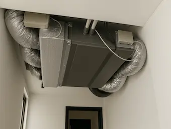

## **Fonctionnement et caractéristiques techniques**

### **Principe de fonctionnement des systèmes gainable et split**

Les systèmes de climatisation gainable et split fonctionnent tous deux sur le principe de la pompe à chaleur air-air, utilisant un fluide frigorigène pour transférer la chaleur entre l'intérieur et l'extérieur d'un bâtiment. Ils sont tous les deux contistués d'un bloc extérieur la pompe, et un système de à l'intérieur. Cependant, leur méthode de distribution de l'air diffère :

- **Climatisation gainable :** Ce système utilise un réseau de gaines dissimulées dans les faux plafonds ou les combles pour distribuer l'air traité à travers des grilles de soufflage discrètes. L'unité centrale, souvent installée dans un espace technique, aspire l'air, le traite (chauffage ou refroidissement) et le redistribue uniformément dans les différentes pièces.
- **Climatisation split ou multi-split :** Ces systèmes se composent d'une ou plusieurs unités intérieures (split) reliées à l"unité extérieure. Chaque unité intérieure gère la température d'une pièce spécifique, permettant une régulation indépendante. Le multi-split peut supporter jusqu'à six unités intérieures, offrant ainsi une grande flexibilité pour climatiser plusieurs espaces avec une seule unité extérieure.

### **Comparaison des performances énergétiques**

En termes d'efficacité énergétique, les deux systèmes présentent des avantages distincts :

- **Climatisation gainable :** Grâce à sa capacité à distribuer l'air de manière homogène, ce système offre un excellent confort thermique avec une consommation d'énergie optimisée. Il est particulièrement efficace pour les grandes surfaces et les nouvelles constructions.
- **Climatisation split ou multi-split :** Ces systèmes permettent une gestion précise de la température pièce par pièce, ce qui peut conduire à des économies d'énergie significatives, surtout lorsque certaines zones ne nécessitent pas de climatisation constante.

### **Avantages et inconvénients techniques**

- **Avantages de la climatisation gainable :**
  - Esthétique : Les unités sont cachées, préservant l'aspect visuel des pièces. Et ne laisse apparaitre que des grilles de ventilation.
  - Confort thermique uniforme : Distribution homogène de l'air.
  - Silencieuse : L'unité centrale est isolée, réduisant les nuisances sonores.
- **Inconvénients de la climatisation gainable :**
  - Installation complexe : Nécessite des travaux importants, notamment pour l'installation des gaines. C'est pourquoi ce système est souvent envisagé dans le cas d'une rénovation globale, d'un comble inutilisé, ou d'une construction neuve qui prévoit son installation.
  - Coût élevé : Investissement initial plus important.
- **Avantages de la climatisation split ou multi-Split :**
  - Flexibilité : Possibilité de climatiser plusieurs pièces indépendamment.
  - Installation plus simple : Moins de travaux nécessaires par rapport au gainable. Adapté au appartement qui ont un extérieur.
- **Inconvénients de la climatisation split ou multi-Split :**
  - Visibilité : Les unités intérieures sont visibles et peuvent occuper de l'espace.
  - Niveau sonore : Peut être plus bruyant selon les modèles.

## **Installation et configuration**

L'installation d'un système de climatisation, qu'il soit gainable ou split, nécessite une planification minutieuse et l'intervention de professionnels qualifiés. Voici les étapes clés pour chaque type de système. Le choix entre ces systèmes dépendra également du contexte de votre projet : la climatisation gainable est plus adaptée aux nouvelles constructions et aux rénovations d'envergure, tandis que le multi-split fonctionne très bien lorsque des travaux lourds ne sont pas envisageables, comme dans un appartement.

### **Climatisation gainable :**

- **Vérification préliminaire :**
  - **Espace disponible :** Assurez-vous de disposer de combles ou de faux plafonds suffisamment spacieux pour accueillir les gaines et l'unité centrale.
  - **Hauteur sous plafond :** Vérifiez que la hauteur sous plafond est adéquate pour l'installation des conduits sans compromettre l'esthétique ou l'espace habitable en créant un faux plafond.
  - **Emplacement de l'unité extérieure :** Identifiez un emplacement approprié pour l'unité extérieure, idéalement éloigné des pièces qui nécessitent le calme (principalement les chambres). Car bien que réduit aujourd'hui l'unité extérieur fait toujours du bruit.
  - **Accès technique :** Un espace technique, comme un comble, est nécessaire pour installer l'unité centrale de distribution de l'air.
- **Processus d'installation :**
  - **Étude préliminaire :** une étude détaillée est réalisée pour déterminer le tracé des gaines et l'emplacement optimal de l'unité centrale.
  - **Installation des gaines :** Les conduits sont soigneusement posés dans les combles ou les faux plafonds pour assurer une distribution uniforme de l'air.
  - **Mise en place de l'unité centrale :** L'unité centrale est généralement installée dans un espace technique pour minimiser les nuisances sonores.
  - **Positionnement des grilles de soufflage :** Les grilles sont stratégiquement placées pour garantir une diffusion optimale de l'air dans chaque pièce.

<figure>
  
  <figcaption>Unité centrale climatisation gainable</figcaption>
</figure>

### **Climatisation split ou multi-split :**

- **Vérification préliminaire :**
  - **Murs porteurs :** Vérifiez la possibilité de percer les murs pour faire passer les liaisons frigorifiques entre les unités intérieures et extérieures. Et vérifier la possibilité de fixer les unités intérieures (split) aur mur, soit car ils sont porteur, soit car solidifier pour supporter le point des splits.
  - **Emplacement de l'unité extérieure :** Identifiez un emplacement approprié pour l'unité extérieure, idéalement proche des unités intérieures pour minimiser la longueur des tuyaux. Et de préférence éloigné des pièces qui nécessitent le calme (surtout les chambre). Car bien que réduit aujourd'hui l'unité extérieur fait quand même un peu de bruit.
  - **Contraintes Esthétiques :** Considérez l'impact visuel des unités intérieures et planifiez leur positionnement pour minimiser l'encombrement.
- **Processus d'Installation :**
  - **Étude préliminaire :** Une étude est effectuée pour déterminer les emplacements des unités intérieures et les trajets des liaisons frigorifiques.
  - **Choix des emplacements :** Chaque unité intérieure est installée dans la pièce à climatiser, souvent fixée au mur.
  - **Connexion à l'unité extérieure :** Les unités intérieures sont reliées à l'unité extérieure par des liaisons frigorifiques, nécessitant des travaux de perçage pour faire passer les tuyaux.
  - **Mise en service :** Une fois les unités installées et connectées, le système est mis en service et réglé pour assurer un fonctionnement optimal.

<figure>
  
  <figcaption>Climatisation split ou multi split</figcaption>
</figure>

## **Coût, maintenance et aides financières**

### **Coût initial et d'entretien des systèmes**

Le coût d'installation et d'entretien des systèmes de climatisation gainable et split/multi-split varie en fonction de plusieurs facteurs, notamment la taille de l'installation, la marque choisie, et les spécificités du projet.

- **Climatisation gainable :**
  - **Coût initial :** L'installation d'un système gainable est généralement plus coûteuse en raison de la complexité des travaux nécessaires pour poser les gaines et l'unité centrale. Le coût peut varier entre 10 000 et 15 000 € pour une installation complète.
  - **Entretien :** Bien que le coût initial soit élevé, l'entretien peut être moins fréquent si le système est correctement installé. Une visite professionnelle tous les deux ans est recommandée pour garantir son bon fonctionnement.
- **Climatisation split ou multi-split :**
  - **Coût Initial :** Le coût d'installation d'un système split ou multi-split est généralement plus abordable, variant entre 2 000 et 4 000 € pour un mono-split et entre 3 000 et 13 000 € pour un multi-split, selon le nombre d'unités intérieures.
  - **Entretien :** Chaque unité intérieure nécessite un entretien régulier, ce qui peut augmenter les coûts à long terme. Une visite annuelle est souvent recommandée pour nettoyer les filtres et vérifier les niveaux de fluide frigorigène.

### **Aides financières et subventions disponibles**

Les systèmes de climatisation réversible, y compris les gainables et les splits, peuvent bénéficier de diverses aides financières et subventions, visant à encourager l'efficacité énergétique et la réduction des émissions de CO2.

- **Prime CEE (Certificats d'Économie d'Énergie) :** Ces primes sont attribuées pour encourager les travaux d'amélioration énergétique, y compris l'installation de systèmes de climatisation reversible (pompeà chaleur air/air) performants.
- **Aides locales :** Certaines collectivités locales proposent des aides spécifiques pour les travaux de rénovation énergétique. Il est conseillé de se renseigner auprès de sa mairie ou sur le site de l'ANIL.
- **MaPrimeRénov' :** Dans le cadre d'une rénovation globale incluant au moins deux gestes d'isolation, l'installation d'un climatiseur réversible peut être subventionnée par cette aide.

### **Impact sur la facture énergétique**

Les systèmes de climatisation gainable et split/multi-split vont avoir un impact significatif sur votre facture énergétique. Pour en savoir plus vous pouvez lire notre article : [Est-ce qu'une climatisation consomme beaucoup ?](/post/est-ce-quune-climatisation-consomme-beaucoup-delectricite)

## **Confort, esthétique et durabilité**

### **Confort thermique et acoustique**

Le confort procuré par un système de climatisation est un critère essentiel à considérer lors du choix entre une climatisation gainable et un système split ou multi-split.

- **Climatisation gainable :**
  - **Confort thermique :** Ce système assure une distribution homogène de l'air dans toutes les pièces, offrant ainsi un confort thermique optimal sans zones froides ou chaudes.
  - **Niveau sonore :** Grâce à l'unité centrale dissimulée dans les combles ou un faux plafond, le système gainable est extrêmement silencieux, garantissant un environnement paisible.
- **Climatisation split ou multi-split :**
  - **Confort thermique :** La possibilité de réguler la température pièce par pièce permet d'adapter le confort thermique aux besoins spécifiques de chaque espace.
  - **Niveau sonore :** Bien que les unités intérieures puissent émettre un léger bruit, les modèles modernes sont conçus pour être aussi silencieux que possible. Toutefois, le niveau sonore peut varier en fonction de la marque et du modèle choisi.

### **Impact esthétique sur l'intérieur**

L'esthétique joue également un rôle important dans le choix d'un système de climatisation, surtout si vous souhaitez préserver l'harmonie visuelle de votre intérieur.

- **Climatisation gainable :**
  - **Discrétion :** L'un des principaux avantages de ce système est sa discrétion. Seules les grilles de soufflage sont visibles, ce qui permet de conserver un intérieur épuré et élégant.
  - **Intégration :** Idéal pour les intérieurs modernes ou minimalistes, où l'absence d'unités visibles est un atout majeur.
- **Climatisation split ou multi-Split :**
  - **Visibilité :** Les unités intérieures sont visibles et peuvent occuper de l'espace mural, ce qui peut être perçu comme un inconvénient esthétique.
  - **Design :** Cependant, de nombreux fabricants proposent des modèles au design soigné, permettant une intégration harmonieuse dans la décoration intérieure.

### Durabilité et respect de l'environnement

La durabilité et l'impact environnemental sont des considérations de plus en plus importantes dans le choix d'un système de climatisation.

- **Climatisation gainable :**
  - **Durabilité :** Bien installé et entretenu, un système gainable peut offrir une longue durée de vie et une grande fiabilité.
  - **Efficacité énergétique :** Sa capacité à distribuer l'air de manière homogène contribue à une meilleure efficacité énergétique, réduisant ainsi l'empreinte carbone.
- **Climatisation split ou multi-split :**
  - **Durabilité :** Les systèmes split sont également réputés pour leur robustesse et leur longévité, à condition de suivre un entretien régulier.
  - **Efficacité énergétique :** La possibilité de réguler la température pièce par pièce permet de réaliser des économies d'énergie significatives, contribuant ainsi à la réduction des émissions de CO2.

## Conseils pour choisir le bon système

- **Évaluer vos besoins :** Prenez en compte la taille de votre logement, le nombre de pièces à climatiser, vos préférences en matière de confort et d'esthétique et surtout les contraintes techniques évoquées plus haut.
- **Consulter un professionnel :** Faites appel à un installateur certifié pour réaliser un bilan thermique et vous proposer une solution adaptée à votre situation. Lui seul pourra valider ou non ce qu'il est possible de faire.
- **Considérer les aides financières :** Renseignez-vous sur les subventions disponibles pour réduire le coût de l'installation et optimiser votre investissement.

## **Conclusion**

Le choix entre une climatisation gainable et un système split ou multi-split dépend de nombreux facteurs, notamment la configuration de votre logement, votre budget, et vos préférences en matière de confort et d'esthétique. La climatisation gainable se distingue par son confort thermique homogène, son silence, et sa discrétion, idéale pour les nouvelles constructions ou les rénovations d'envergure. En revanche, le système split ou multi-split offre une grande flexibilité d'installation qui est très rapide, et une régulation précise de la température pièce par pièce, parfait pour les logements où des travaux lourds ne sont pas envisageables.

En fin de compte, il est essentiel de bien évaluer vos besoins et de consulter un professionnel pour vous guider vers la solution la plus adaptée pour faire un choix qui optimisera votre confort tout en respectant votre budget.
