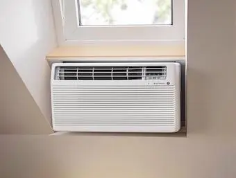
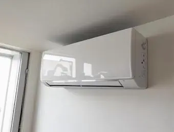
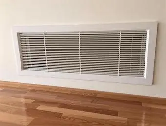

## Facteurs influant le coût d'installation

Le coût d'installation d'une climatisation réversible varie en fonction de plusieurs facteurs, comme le type d'installation souhaitée, la surface à climatiser,... . Comprendre ces éléments vous aidera à mieux estimer le budget nécessaire pour votre projet.

### Le type de climatisation

- **Monobloc** : Ce type de climatisation est le plus simple à installer et nécessite peu de travaux (création d'un trou vers l'extérieur pour capter de l'air). Il est idéal pour les petites pièces ou les logements de petite taille. Le coût d'un climatiseur monobloc varie entre 500 € et 2500 €. Ce système est compacte, cependant, il est généralement moins efficace et plus bruyant que les autres types de climatiseurs. La pompe à chaleur étant à l'intérieur.

<figure>
  
</figure>

- **Monosplit** : Composé d'une unité extérieure et d'une unité intérieure, ce système est plus efficace et silencieux que le monobloc. Le prix d'un climatiseur monosplit se situe entre 2 000 € et 4 000 €. Il est parfait pour les maisons ou appartements, offrant un bon compromis entre performance et coût. L'installation nécessite des travaux pour relier les unités intérieure et extérieure, mais reste relativement simple. Attention, il nécessite tout de même iun espace extérieur plus ou moins important pour le bloc ectérieur.

<figure>
  
</figure>

- **Multisplit** : Ce système comprend plusieurs unités intérieures reliées à une seule unité extérieure, permettant de climatiser plusieurs pièces indépendamment. Le coût d'un multisplit peut aller de 3 000 € à 10 000 €. Il est idéal pour les grandes maisons ou les bureaux où chaque pièce nécessite une température différente. L'installation est plus complexe et coûteuse, mais offre une grande flexibilité et un confort optimal.
- **Gainable** : Ce type de climatisation est intégré dans les combles ou les faux plafonds, offrant une solution discrète et esthétique. Cependant, l'installation est plus complexe et coûteuse, avec des prix allant de 10 000 € à 15 000 €. Ce système est souvent choisi pour les nouvelles constructions ou les rénovations majeures, car il nécessite des travaux importants pour l'intégration des conduits. Il offre une climatisation uniforme et silencieuse, parfaite pour les grandes surfaces et des prestations hautes gammes.

<figure>
  
</figure>

### La puissance et la marque de l'appareil

La puissance de la climatisation doit être adaptée à la surface à climatiser. Une puissance insuffisante entraînera une surconsommation d'énergie, tandis qu'une puissance excessive augmentera inutilement le coût d'achat. Les marques reconnues comme Daikin, Mitsubishi, ou Toshiba offrent des produits plus chers mais souvent plus fiables et économes en énergie. Ces marques investissent également dans la recherche et le développement pour proposer des technologies innovantes et des performances optimales. Lire notre article [Les meilleurs pompes à chaleur et climatisations](/post/optimisez-votre-confort-thermique-comparatif-des-meilleures-pompes-a-chaleur-et-climatisation-en-2025)

### La surface à climatiser et l'isolation du logement

Plus la surface à climatiser est grande, plus le coût d'installation sera élevé. Une bonne isolation permet également de réduire la puissance nécessaire et donc le coût de la climatisation. Il est recommandé de réaliser un bilan thermique avant l'installation pour déterminer la puissance adéquate. Un professionnel qualifié le proposera dans sa prestation. Une bonne isolation thermique permet de maintenir la température intérieure plus facilement, réduisant ainsi la charge de travail de la climatisation et prolongeant sa durée de vie.

### Technologie Inverter

La technologie Inverter permet de réguler la vitesse du compresseur en fonction des besoins énergétiques, évitant ainsi les cycles marche/arrêt qui consomment beaucoup d'énergie. Bien que les modèles Inverter soient environ 10 % plus chers, ils offrent une meilleure efficacité énergétique et un confort accru. Aujourd'hui la plus part des modèles intègres cette technologie. Elle permet de maintenir une température constante et d'économiser jusqu'à 30 % d'énergie par rapport aux systèmes traditionnels, ce qui compense largement le coût initial plus élevé. Pour en savoir plus sur son fonctionnement [voir notre article sur le sujet](/post/la-technologie-inverter-pour-pompes-a-chaleur-fonctionnement-avantages-et-couts).

## Détails des coûts d'installation

### Combien coute une climatisation ?

- **Monobloc** : Entre 500 € et 2 500 €.
- **Monosplit** : Entre 2 000 € et 4 000 €.
- **Multisplit** : Entre 3 000 € et 10 000 €.
- **Gainable** : Entre 10 000 € et 15 000 €.

### Coûts de la main-d'oeuvre et de la mise en service

L'installation d'une climatisation réversible nécessite l'intervention d'un professionnel qualifié pour garantir une installation conforme aux normes et un fonctionnement optimal. Le coût de la main-d'œuvre varie en fonction de la complexité des travaux et de la région.

- **Monosplit** : En moyenne, il faut compter entre 800 € et 1 500 € pour l'installation. Ce coût inclut la pose des unités, le raccordement électrique, et les tests de fonctionnement.
- **Multisplit** : Pour un multisplit, le coût de l'installation varie entre 1 000 € et 2 500 €. L'installation est plus complexe en raison du nombre d'unités intérieures et des travaux de raccordement nécessaires.
- **Gainable** : Pour l'installation d'une solution gainable, il faut compter entre 2 000 € et 12 000 € suivant la complexité de l'installation. Ce coût inclut les travaux de maçonnerie, l'intégration des conduits, et la mise en place des unités.

La mise en service, obligatoire pour garantir le bon fonctionnement de l'appareil, coûte entre 150 € et 450 €. Cette étape est indispensable pour vérifier que l'installation est correcte et que le système fonctionne de manière optimale. Elle inclut les tests de performance, les réglages nécessaires, et la formation de l'utilisateur à l'utilisation de l'appareil.

## Aides financières et réductions

Il existe peu d'aides pour l'installation de climatisation, mais la principale aide envisageable est celle dite des Certificats d'Économies d'Énergie (CEE), et uniquement pour une pompe à chaleur air-air (climatisation réversible). Les CEE sont des aides financières versées par les fournisseurs d'énergie pour encourager les économies d'énergie. Ces certificats visent à promouvoir les travaux de rénovation énergétique et à réduire la consommation d'énergie des ménages.

### Les Certificats d'Économies d'Énergie (CEE)

Les CEE sont un dispositif mis en place par l'État pour inciter les fournisseurs d'énergie à promouvoir les économies d'énergie. Ces fournisseurs, appelés "obligés", doivent réaliser des actions d'économies d'énergie auprès de leurs clients. En contrepartie, ils obtiennent des certificats qu'ils peuvent revendre ou utiliser pour remplir leurs obligations.

Les montants des aides varient en fonction des travaux réalisés et des ressources du foyer. Par exemple, les ménages modestes peuvent bénéficier de primes plus élevées, appelées "primes coup de pouce", qui peuvent couvrir une partie significative du coût de l'installation. Pour une climatisation réversible, les CEE peuvent représenter plusieurs centaines d'euros d'économies.

### Conditions pour bénéficier des CEE

Pour bénéficier des CEE, il est impératif de faire appel à un artisan certifié RGE (Reconnu Garant de l'Environnement). Cette certification garantit que l'artisan respecte des critères de qualité et de performance énergétique. Elle est obligatoire pour la plupart des aides financières liées à la rénovation énergétique, y compris les CEE.

Il est également important de faire la demande de CEE avant de signer le devis et de commencer les travaux. En effet, les fournisseurs d'énergie doivent valider votre dossier avant le début des travaux pour que vous puissiez bénéficier de l'aide. Une fois les travaux terminés, vous devrez fournir les factures et les attestations de conformité pour recevoir le montant de l'aide.

### Autres aides possibles

Bien que les CEE soient la principale aide disponible pour l'installation de climatisation, il peut exister d'autres dispositifs locaux ou régionaux. Certaines collectivités territoriales proposent des subventions ou des prêts à taux zéro pour encourager les travaux de rénovation énergétique. Il est donc recommandé de se renseigner auprès de votre mairie ou de votre conseil régional pour connaître les aides disponibles dans votre région.

Il existe peu d'aide pour l'installation de climatisation, la seule envisageable est celle dite des Certificats d'Économies d'Énergie (CEE) et uniquement pour une pompe à chaleur air-air (climatisation réversible).

[Pour en savoir plus sur les CEE voir notre article sur le sujet](/post/tout-savoir-pour-obtenir-la-prime-de-renovation-certificats-deconomies-denergie-cee)

## Entretien et maintenance

L'entretien régulier de votre climatisation est essentiel pour garantir son bon fonctionnement, optimiser ses performances, et prolonger sa durée de vie. Un entretien bien réalisé permet également de réduire la consommation d'énergie et d'éviter les pannes coûteuses. Voici les principaux aspects à considérer pour l'entretien de votre système de climatisation.

### Contrat d'entretien annuel

Un contrat d'entretien annuel coûte généralement entre 100 € et 300 € par an, en fonction de la complexité du système et de la région. Ce contrat comprend plusieurs services essentiels :

- **Nettoyage des filtres** : Les filtres à air doivent être nettoyés ou remplacés régulièrement pour assurer une bonne qualité de l'air et éviter les obstructions qui peuvent réduire l'efficacité de l'appareil. Un filtre propre permet également de réduire la consommation d'énergie.
- **Vérification des niveaux de fluide frigorigène** : Le fluide frigorigène est indiospensable pour le fonctionnement de la climatisation. Un niveau insuffisant peut entraîner une baisse de performance et des pannes. Le professionnel vérifiera et rechargera le fluide si nécessaire.
- **Contrôle général de l'appareil** : Ce contrôle inclut la vérification des composants électriques, des connexions, et des performances globales du système. Il permet de détecter et de corriger les problèmes potentiels avant qu'ils ne deviennent graves.

### Fréquence de l'entretien

L'entretien doit être réalisé tous les deux ans par un professionnel qualifié pour toute les climatisation d'une puissance supérieur à 4kW. Cette fréquence permet de maintenir la garantie du fabricant et d'assurer que le système fonctionne de manière optimale. Un entretien régulier permet également de prévenir les fuites de fluide frigorigène, qui peuvent être nocives pour l'environnement et coûteuses à réparer.

### Importance de l'entretien professionnel

Faire appel à un professionnel pour l'entretien de votre climatisation réversible est indisepnsable. Un technicien qualifié dispose des compétences et des outils nécessaires pour effectuer un diagnostic précis et réaliser les interventions nécessaires. Il peut également vous conseiller sur les bonnes pratiques pour optimiser l'utilisation de votre système et prolonger sa durée de vie.

### Entretien par l'utilisateur

En plus de l'entretien professionnel, il est recommandé de réaliser quelques gestes simples pour maintenir votre climatisation en bon état :

- **Nettoyage des unités intérieures** : Essuyez régulièrement les unités intérieures avec un chiffon humide pour enlever la poussière et les saletés.
- **Vérification des entrées et sorties d'air** : Assurez-vous que rien n'obstrue les entrées et sorties d'air, tant à l'intérieur qu'à l'extérieur.
- **Surveillance des performances** : Soyez attentif aux signes de dysfonctionnement, comme des bruits inhabituels, une baisse de performance, ou des odeurs étranges. Si vous remarquez un problème, contactez un professionnel sans attendre.

En suivant ces recommandations, vous pourrez garantir le bon fonctionnement de votre climatisation et profiter d'un confort optimal tout au long de l'année.

## Conseils pour optimiser les coûts

1. **Choix d'un professionnel certifié** : Faire appel à un artisan certifié RGE permet de bénéficier des aides financières. C'est le cas des artisans Akelia
2. **Astuces pour réduire les coûts** :
  - Optez pour un modèle adapté à la surface à climatiser pour éviter les surcoûts.
  - Améliorez l'isolation de votre logement pour réduire la puissance nécessaire.
  - Profitez des aides financières disponibles pour diminuer le coût d'installation.
  - Bien entretenir votre pompe à chaleur afin d'optimiser son rendement et sa durée de vie.
3. **Choix du modèle** :
  - **Appartement** : Un monosplit peut être suffisant pour un petit appartement, tandis qu'un multisplit est plus adapté pour les grands espaces. Tout dépend de votre besoin, notamment la nécessité ou non d'avoir une arrivée d'air chaud ou d'air frais dans l'ensemble des pièces.
  - **Maison** : Un système multisplit ou gainable est souvent nécessaire pour couvrir plusieurs pièces.
  - **Studio** : Un climatiseur monobloc peut être une bonne solution, cependant attention c'est bruyant.
4. **Réglementation** :
  - **Autorisations** : Pour installer une climatisation, vous devez obtenir l'autorisation de la copropriété et déposer une déclaration de travaux à la mairie si l'unité extérieure est visible depuis l'espace public. Cela est souvent moins contraignant pour une maison.

## Conclusion

L'installation d'une climatisation représente un investissement, mais elle offre de nombreux avantages en termes de confort et d'économies d'énergie. En comprenant les différents facteurs influençant le coût d'installation et en profitant des aides financières disponibles, vous pouvez optimiser votre budget et réaliser un investissement intéressant. C'est également une solution rapide et facile pour améliorer son DPE. N'oubliez pas que l'entretien régulier est essentiel pour garantir la longévité de votre appareil et maintenir ses performances.
