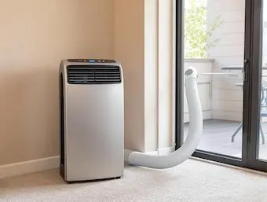
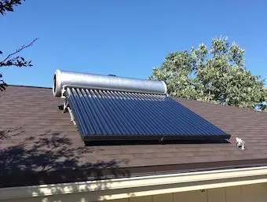

## Les différents types de climatiseurs

Le marché de la climatisation offre une variété de solutions adaptées à différents besoins et contraintes. Chaque type de climatiseur présente des caractéristiques spécifiques qui le rendent plus ou moins adapté à votre situation. Voici un tour d'horizon des principaux types de climatiseurs disponibles :

### Climatiseur monobloc

Le climatiseur monobloc est un système compact et autonome, idéal pour les petits espaces ou les pièces de moins de 30 m². Il se distingue par son installation simple et son coût abordable. Cependant, il présente quelques inconvénients notables :

**Avantages** :

- Facilité d'installation et mobilité, souvent monté sur roulettes.
- Solution économique pour un usage ponctuel.
- Adapté aux petites surfaces et aux logements où l'installation d'une unité extérieure est impossible.

**Inconvénients** :

- Niveau sonore élevé, pouvant causer des nuisances.
- Efficacité limitée pour les grandes pièces.
- Nécessite une évacuation de l'air chaud vers l'extérieur, souvent avec un trou dans le mur.

<figure>
  
  <figcaption>Climatisation monobloc</figcaption>
</figure>

### Climatiseur split (révesrible)

Le climatiseur réversible, également connu sous le nom de pompe à chaleur air-air, offre la possibilité de chauffer et de refroidir votre intérieur. C'est une solution polyvalente et économique. Le climatiseur split est composé de deux unités : une unité intérieure et une unité extérieure. Ce système est particulièrement apprécié pour sa performance et son faible niveau sonore. Il s'agit du principale système de climatisation.

**Avantages** :

- Silencieux, car le compresseur est situé à l'extérieur.
- Fonctionne en mode chauffage et climatisation, idéal pour un usage toute l'année.
- Efficace pour climatiser des espaces moyens à grands.
- Disponible en plusieurs configurations : mural, plafonnier, ou encastrable.

**Inconvénients** :

- Coût d'installation plus élevé.
- Nécessite une installation professionnelle et un espace extérieur pour l'unité extérieure.
- En copropriété, il nécessite un accord en assemblé syndical.
- Et si il est visible depuis la rue une autorisation d'urbanisme (demande préalable).

<figure>
  
  <figcaption>Climatiseur split ou multisplit</figcaption>
</figure>

### Climatiseur multisplit

Le climatiseur multisplit est une extension du système split, permettant de connecter plusieurs unités intérieures à une seule unité extérieure. Il est idéal pour climatiser de grands espaces ou plusieurs pièces.

**Avantages** :

- Permet une gestion indépendante de la température dans chaque pièce.
- Solution flexible et adaptable aux besoins spécifiques de chaque espace.

**Inconvénients** :

- Installation complexe et coûteuse.
- Nécessite un espace suffisant pour l'unité extérieure.

### Climatiseur mobile (de fenetre)

Le climatiseur de fenêtre est une solution simple et économique pour refroidir une pièce spécifique. Il est facile à installer et ne nécessite pas d'unité extérieure.

**Avantages** :

- Installation rapide et facile.
- Solution économique pour un usage ponctuel.

**Inconvénients** :

- Niveau sonore élevé.
- Moins efficace pour les grandes surfaces.
- Nécessite une évacuation de l'air chaud vers l'extérieur souvent par une fenetre qui reste ouverte et fais entrer le l'air.

<figure>
  
  <figcaption>Exemple de climatiseur mobile</figcaption>
</figure>

### Climatiseur solaire thermique

Le climatiseur solaire thermique utilise l'énergie solaire pour augmenter la température du fluide réfrigérant, offrant ainsi une alternative écologique.

**Avantages** :

- Réduction de l'empreinte carbone grâce à l'utilisation d'énergie renouvelable.
- Peut également produire de l'eau chaude sanitaire.

**Inconvénients** :

- Investissement initial élevé.
- Efficacité dépendante des conditions d'ensoleillement.

<figure>
  
  <figcaption>Exemple de climatiseur solaire thermique</figcaption>
</figure>

### Climatisation gainable

La climatisation est une pompe à chaleur air-air mais elle utilise un système de ventilation dit gainable. C'est une solution discrète où les unités intérieures sont dissimulées dans les combles ou les faux plafonds, idéale pour les nouvelles constructions.

**Avantages** :

- Esthétique et discrète, avec des bouches de ventilation intégrées.
- Distribution uniforme de l'air conditionné.

**Inconvénients** :

- Installation complexe et coûteuse, surtout en rénovation.
- Nécessite un espace suffisant pour l'installation des gaines.

<figure>
  
  <figcaption>Exemple de bouche d&#x27;aération d&#x27;une climatisation gainable</figcaption>
</figure>

## Critères de choix d'un climatiseur

Choisir le bon climatiseur pour votre logement nécessite de prendre en compte plusieurs critères essentiels. Voici les principaux éléments à considérer pour faire un choix éclairé :

### Puissance et consommation énergétique

- **Puissance** : La puissance du climatiseur doit être adaptée à la surface de la pièce ou de l'espace à climatiser. Une puissance insuffisante ne permettra pas de rafraîchir efficacement, tandis qu'une puissance excessive entraînera une consommation d'énergie inutile. En général, on estime qu'il faut environ 100 W par mètre carré pour une hauteur sous plafond standard de 2,50 m.
- **Consommation énergétique** : Optez pour des modèles avec une bonne classe énergétique et des coefficients SCOP et SEER élevés, qui indiquent une meilleure efficacité énergétique. Les technologies comme l'Inverter permettent de moduler la puissance et de réduire la consommation.

### Niveau sonore et esthétique

- **Niveau sonore** : Le bruit généré par le climatiseur peut être un facteur de nuisance, surtout dans les espaces de vie ou de travail. Les climatiseurs split sont généralement plus silencieux car le compresseur est situé à l'extérieur. Vérifiez les décibels (dB) émis par l'appareil pour vous assurer qu'il correspond à vos attentes en termes de confort acoustique. Attention, le module extérieur est également bruyant, ce qui peut être une nuisance pour vous mais également pour vos voisins.
- **Esthétique** : L'apparence du climatiseur peut également jouer un rôle dans votre choix, surtout si vous souhaitez qu'il s'intègre harmonieusement à votre décoration intérieure. Certains modèles sont conçus pour être discrets, voire invisibles, comme les climatiseurs cassettes ou gainables.

### Coût d'achat et d'installation

- **Coût d'achat** : Le prix des climatiseurs varie en fonction du type, de la puissance, et des fonctionnalités. Les climatiseurs monoblocs sont généralement moins chers, tandis que les systèmes split ou réversibles peuvent représenter un investissement plus important.
- **Coût d'installation** : L'installation d'un climatiseur, surtout pour les systèmes split ou multisplit, nécessite souvent l'intervention d'un professionnel. Ce coût peut varier en fonction de la complexité de l'installation. Le plus couteux étant la climatisation gainable qui nécessite souvent des travaux importants qu'il est intéressant de prévoir lors d'une rénovation d'empleur ou la construciton d'une maison neuve.

### Adaptabilité à la surface et aux besoins spécifiques

- **Surface à climatiser** : Le choix du climatiseur dépend de la taille de l'espace à refroidir. Pour une seule pièce, un climatiseur monobloc ou monosplit peut suffire. Pour plusieurs pièces ou un grand espace, un système multisplit ou une climatisation gainable sera plus adapté.
- **Besoins spécifiques** : Réfléchissez à l'usage que vous souhaitez faire de votre climatiseur. S'agit-il d'un besoin ponctuel ou d'un usage continu, notamment s'il s'agit également d'une solution de chauffage ? Certains modèles, comme les climatiseurs réversibles, offrent la possibilité de chauffer en hiver, ce qui peut être un avantage si vous cherchez une solution tout-en-un.

## Technologies innovantes

Les avancées technologiques dans le domaine de la climatisation ont permis de développer des systèmes plus efficaces, économes en énergie et respectueux de l'environnement. Voici un aperçu des technologies innovantes qui révolutionnent le marché de la climatisation :

### Technologie Inverter

La technologie Inverter est l'une des innovations les plus significatives dans le domaine de la climatisation. Contrairement aux systèmes traditionnels qui fonctionnent selon un principe "tout ou rien", les climatiseurs équipés de la technologie Inverter ajustent leur puissance en fonction des besoins réels de refroidissement.

**Fonctionnement** : Le compresseur d'un climatiseur Inverter peut moduler sa vitesse, ce qui permet de maintenir une température constante sans cycles de marche/arrêt fréquents. Cela réduit les pics de consommation énergétique et améliore le confort en évitant les variations brusques de température.

**Avantages** :

- **Économies d'Énergie** : Jusqu'à 30 % d'économies d'énergie par rapport aux systèmes classiques.
- **Confort Amélioré** : Température stable et confort accru grâce à une régulation précise.
- **Durabilité** : Moins de sollicitations mécaniques, ce qui prolonge la durée de vie de l'appareil.

### Climatiseurs solaires thermiques

Les climatiseurs solaires thermiques représentent une alternative écologique en utilisant l'énergie solaire pour alimenter le système de climatisation.

**Fonctionnement** : Des panneaux solaires thermiques chauffent un fluide qui est ensuite utilisé pour refroidir l'air intérieur via un processus de compression thermique.

**Avantages** :

- **Écologique** : Réduction de l'empreinte carbone grâce à l'utilisation d'énergie renouvelable.
- **Économique** : Réduction des coûts énergétiques à long terme.
- **Polyvalence** : Certains modèles peuvent également produire de l'eau chaude sanitaire.

## Installation et entretien

L'installation conforme et l'entretien de votre climatiseur sont indisensables pour garantir efficacité et durabilité. Voici les points clés à considérer :

### Importance de l'installation professionnelle

- **Expertise requise** : L'installation de certains types de climatiseurs, notamment les systèmes split et multisplit, nécessite l'intervention de professionnels qualifiés. Ces experts sont formés pour manipuler les fluides frigorigènes et assurer une installation conforme aux normes de sécurité.
- **Conformité réglementaire** : En France, l'installation de climatiseurs est soumise à des réglementations strictes, notamment concernant les nuisances sonores et les distances minimales à respecter par rapport aux propriétés voisines. Un professionnel pourra vous guider pour choisir un emplacement conforme et optimiser les performances de votre appareil.

### Contraintes d'installation

- **Réglementations d'urbanisme** : Avant d'installer un climatiseur, renseignez-vous sur les réglementations locales concernant les nuisances sonores et l'emplacement des unités extérieures. En copropriété, il est souvent nécessaire d'obtenir l'autorisation du syndic.
- **Distance et emplacement** : L'unité extérieure doit être installée à une distance minimale des propriétés voisines pour éviter les nuisances sonores. Une distance de 6 mètres est généralement recommandée pour une climatisation simple, et jusqu'à 10 mètres pour une pompe à chaleur réversible.
- **Copropriété** : Dans une copropriété il est nécessaire d'obtenir l'autorisation de l'assemblée générale pour pouvoir installer une climatisation.

### Conseils d'entretien pour une durée de vie optimale

- **Entretien régulier** : Un entretien régulier est essentiel pour maintenir les performances de votre climatiseur. Cela inclut le nettoyage des filtres, le dépoussiérage des ventilateurs, et la vidange des bacs à condensats.
- **Inspection annuelle** : Bien que la réglementation impose un entretien tous les deux ans pour les appareils contenant plus de 2 kg de fluide frigorigène, il est recommandé de faire inspecter votre climatiseur annuellement pour prolonger sa durée de vie et optimiser son efficacité.
- **Contrats d'entretien** : Souscrire à un contrat d'entretien avec un professionnel peut être une solution pratique pour assurer un suivi régulier et conforme aux exigences légales.
- **Espérance de Vie** : Avec un entretien adéquat, les climatiseurs peuvent durer entre 15 et 25 ans. Les pompes à chaleur air-air et air-eau réversibles ont une durée de vie similaire, à condition qu'elles soient correctement entretenues.

## Aides et subventions

Pour encourager l'adoption de solutions de climatisation économes en énergie, des aides financières sont possibles en France.

### Dispositifs d'aides financières

- **Certificats d'Économie d'Énergie (CEE)** : Ce dispositif permet de bénéficier de primes pour l'installation de climatiseurs (pompe à chaleur air/air) performants et économes en énergie. Les CEE sont souvent proposés par des fournisseurs d'énergie.

## Conseils d'utilisation

Pour maximiser l'efficacité et la durée de vie de votre climatiseur, voici quelques conseils d'utilisation :

- **Éviter les chocs thermiques** : Réglez la température de manière progressive pour éviter les chocs thermiques, qui peuvent être inconfortables et inefficaces sur le plan énergétique. Limiter la différence de température à 5/6°C en dessous de la température extérieur. Ne pas abaisser le température en dessous de 26°C
- **Fonctionnement continu** : Privilégiez un fonctionnement continu à basse puissance plutôt que des cycles fréquents de marche/arrêt, ce qui est plus économique et moins stressant pour l'appareil.
- **Entretien régulier** : Nettoyez régulièrement les filtres et vérifiez les niveaux de fluide frigorigène pour maintenir les performances de votre climatiseur.

## Conclusion

Choisir le bon climatiseur pour votre logement est une décision importante qui nécessite de prendre en compte plusieurs critères, des technologies disponibles aux contraintes d'installation et d'entretien. En optant pour un système adapté à vos besoins et en respectant les bonnes pratiques d'utilisation, vous pourrez profiter d'un confort optimal tout en réalisant des économies d'énergie. N'oubliez pas de vous renseigner sur les aides financières disponibles pour rendre votre investissement encore plus avantageux. Avec ces conseils, vous êtes désormais prêt à faire un choix éclairé et à profiter d'un environnement intérieur agréable tout au long de l'année.
