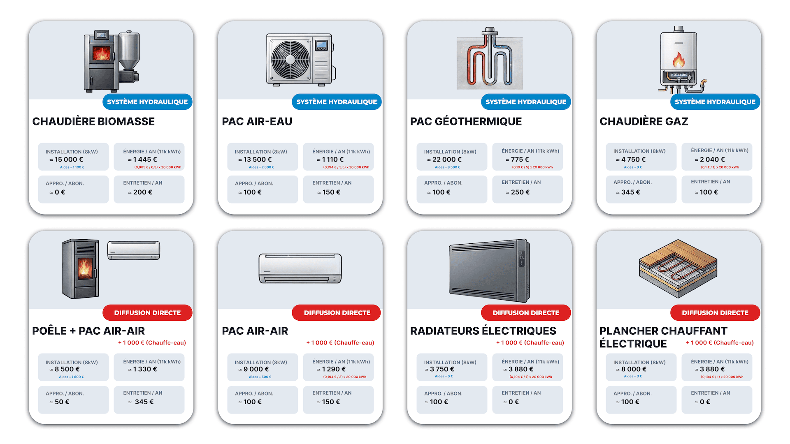
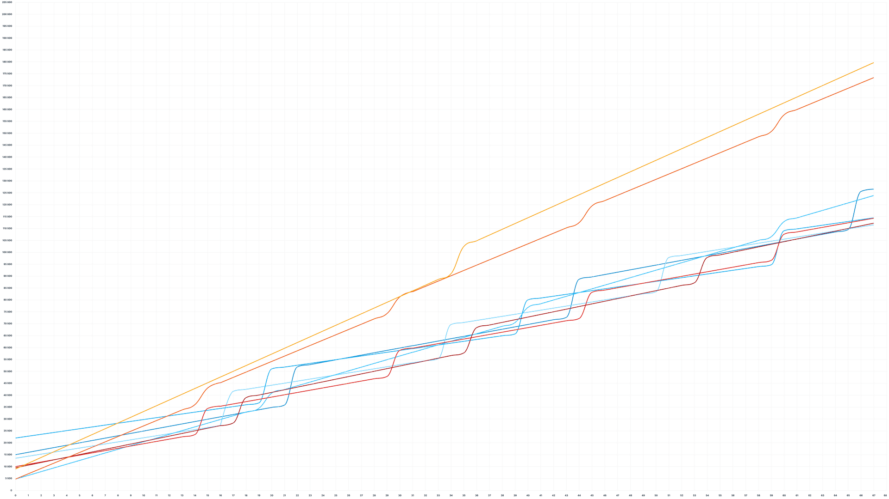

## Pourquoi le prix d'achat d'un chauffage est un piège financier

Lors du remplacement d'un système de chauffage, l'attention se focalise quasi systématiquement sur le montant de l'investissement initial, l'obtention des subventions et les arguments des brochures commerciales. Cette approche occulte l'essentiel : le chauffage n'est pas un équipement ménager ordinaire, mais un poste de dépense récurrent qui engage les finances d'un foyer pendant quinze à trente ans.

### La différence majeure entre investissement initial et coût global de possession

Opter pour une solution économique à l'achat peut rapidement se transformer en désastre financier. Un équipement peu coûteux à l'installation mais gourmand en énergie peut générer sur sa durée de vie des dépenses globales trois à cinq fois supérieures à celles d'un système à forte intensité d'investissement initial. Pour évaluer la rentabilité réelle d'une installation, il est impératif d'intégrer le **coût global de possession** (TCO), qui additionne le prix des travaux déduit des aides financières, les coûts annuels d'énergie, les abonnements aux réseaux, l'entretien obligatoire et le renouvellement du matériel à échéance.

### Les trois variables qui déterminent la facture énergétique réelle d'un logement

Pour calculer précisément les charges d'un foyer, trois critères physiques et économiques s'imposent :

1. **Le besoin thermique annuel du bâtiment :** Exprimé en kilowattheures (kWh), il dépend directement de la surface, de la qualité de l'isolation et du climat local. Pour une maison standard de 100 m² située à Tours et modérément isolée, ce besoin s'élève à 20 000 kWh de chaleur par an.
2. **Le prix unitaire du vecteur énergétique :** Le coût brut d'un kWh varie du simple au triple selon qu'il s'agisse de bois (pellets), de gaz naturel ou d'électricité.
3. **Le rendement de conversion de l'équipement :** Il s'agit de la capacité de l'appareil à transformer l'énergie souscrite en chaleur réellement restituée dans l'habitat.

### Le rôle fondamental du rendement thermique et du coefficient de performance

Le rendement thermique mesure le rapport entre la quantité d'énergie consommée par l'appareil et la chaleur produite. Un système affichant un rendement de 50 % nécessite d'acheter 2 kWh d'énergie pour délivrer 1 kWh de chaleur utile. À l'inverse, les technologies thermodynamiques modernes (pompes à chaleur) exploitent les calories gratuites de l'environnement, leur permettant de restituer plus d'énergie calorifique qu'elles ne consomment d'électricité. On parle alors de **coefficient de performance** (COP). Une machine affichant un COP de 3,5 (soit un rendement de 350 %) délivre 3,5 kWh de chaleur pour seulement 1 kWh d'électricité facturé.

## L'analyse des systèmes de chauffage hydrauliques

Les systèmes dits hydrauliques ou indirects utilisent un réseau d'eau chaude pour alimenter des radiateurs ou un plancher chauffant. Ils présentent l'avantage de pouvoir assurer simultanément le chauffage du logement et la production d'eau chaude sanitaire (ECS).

### La chaudière biomasse : une énergie abordable face à un investissement lourd

La chaudière à granulés de bois (biomasse) constitue l'un des équipements les plus chers du marché à l'achat. Pour une maison de 100 m², le coût d'installation s'élève à environ **15 000 €**. Bien qu'il s'agisse d'une énergie renouvelable, le montant moyen des aides étatiques s'établit à **1 100 €** (avec des majorations possibles selon le niveau de revenu).

Sur le plan technique, une chaudière biomasse moderne affiche un rendement moyen de **90 %**. Pour couvrir le besoin annuel de 20 000 kWh de la maison de référence à Tours, elle consomme environ 22 200 kWh de granulés. Avec un coût du kWh de bois estimé à 0,06 €, le coût de production de la chaleur revient à environ 0,07 € du kWh restitué. La facture d'énergie annuelle s'élève ainsi à **1 400 €**.

En ajoutant un contrat d'entretien obligatoire d'environ **200 € par an** et une livraison de combustibles généralement offerte pour ce volume, la chaudière biomasse associe un investissement initial lourd à l'un des coûts d'énergie les plus bas du marché.

### La pompe à chaleur air/eau : une efficacité remarquable mais dépendante du climat

La pompe à chaleur (PAC) air/eau capte les calories de l'air extérieur pour les injecter dans le circuit hydraulique. Son coût d'installation moyen tourne autour de **13 500 €**. Elle bénéficie de subventions significatives, s'élevant en moyenne à **2 800 €** et pouvant atteindre **10 000 €** pour les ménages les plus modestes, ce qui réduit considérablement le reste à charge.

Sous un climat tempéré comme celui de la région de Tours, le rendement annuel moyen de la PAC air/eau s'établit à **350 %**. Concrètement, sur les 3,5 kWh de chaleur restitués, 1 kWh provient du réseau électrique et 2,5 kWh sont extraits de l'air extérieur. La consommation électrique annuelle baisse ainsi à environ 5 700 kWh. Malgré un coût de l'électricité trois à quatre fois supérieur à celui du bois, la facture d'énergie annuelle chute à **1 100 €**, soit une économie de 25 % par rapport à la biomasse.

Cependant, l'efficacité d'une PAC air/eau varie fortement selon la rigueur du climat :

- En fin d'automne, par température douce, son rendement peut atteindre **500 %**.
- Lors des nuits d'hiver les plus froides, l'extraction des calories devient difficile et le rendement peut chuter entre **200 % et 250 %**.

À cette facture énergétique s'ajoutent un surcoût d'abonnement électrique (environ **100 € par an**) lié à la puissance souscrite, ainsi qu'un entretien annuel obligatoire d'environ **150 €**.

### La pompe à chaleur géothermique : l'excellence thermique amortie par les aides

La géothermie prévient le risque de baisse de rendement hivernal en puisant les calories dans le sol au moyen d'un forage pouvant atteindre 100 mètres de profondeur. C'est l'installation la plus coûteuse, nécessitant un budget global de **22 000 €**. En contrepartie, la géothermie est le système le plus soutenu par les pouvoirs publics, avec une aide moyenne de **9 000 €**, pouvant grimper jusqu'à **16 000 €**.

La température de la terre restant constante tout au long de l'année, la PAC géothermique délivre un rendement moyen exceptionnel de **500 %** (1 kWh consommé = 5 kWh de chaleur produits). Il s'agit du niveau de performance le plus élevé en chauffage individuel.

Pour la maison de référence, la dépense d'énergie annuelle s'effondre à **775 €**, représentant le coût au kWh de chaleur le plus bas de toutes les technologies existantes. Avec **100 € d'abonnement électrique supplémentaire** et **250 € d'entretien annuel**, la géothermie exige un besoin thermique important pour amortir la lourdeur de ses travaux initiaux, mais s'avère imbattable sur le long terme.

### La chaudière au gaz : l'accessibilité à l'achat rattrapée par les frais de réseau

Seule technologie utilisant une énergie fossile dans ce comparatif, la chaudière au gaz à condensation conserve un argument de poids : son coût d'installation extrêmement faible, estimé à **4 750 €**. Exclue des dispositifs d'aide à la transition énergétique, elle ne bénéficie d'aucune subvention.

Son rendement s'établit à **100 %**, atteignant parfois **110 %** grâce à la récupération de chaleur dans les fumées de condensation. Le gaz naturel étant environ deux fois moins cher que l'électricité, la facture d'énergie annuelle atteint **2 000 €** pour 20 000 kWh de besoin.

Le point faible de la chaudière gaz réside dans ses frais fixes : l'abonnement au réseau de distribution s'élève à **345 € par an**, soit le montant le plus cher du marché. Avec un entretien annuel d'environ **100 €**, la faible mise de départ s'efface progressivement devant l'accumulation des factures de combustible et d'abonnement.

## L'analyse des systèmes à air et du chauffage électrique direct

Contrairement aux installations hydrauliques, les systèmes dits directs chauffent directement l'air ambiant et ne permettent pas de produire l'eau chaude sanitaire. L'installation d'un ballon d'eau chaude indépendant (estimé à **1 000 €**) est donc indispensable.

### Poêle à biomasse et climatisation réversible : la contrainte du double entretien

L'association d'un poêle à bois ou à pellets et d'une climatisation réversible (PAC air/air) vise à concilier le plaisir de la flamme et la régulation automatique des températures. Un poêle seul ne pouvant chauffer l'ensemble des pièces d'une maison de 100 m² (notamment les chambres et pièces d'eau), la climatisation ou des convecteurs interviennent en appoint.

L'installation combinée représente un budget de **8 500 €** (hors chauffe-eau), avec des aides financières moyennes de **1 600 €** concentrées sur l'appareil à bois. En répartissant la charge thermique à 60 % pour le poêle et 40 % pour la pompe à chaleur air/air, la facture d'énergie annuelle s'élève à environ **1 300 €**.

Si le coût d'approvisionnement en combustible reste modéré, cette solution souffre d'un coût de maintenance élevé. L'entretien cumulé du poêle (ramonage) et du système thermodynamique dépasse **350 € par an**, sans compter un surcoût d'abonnement électrique d'environ **50 €**.

### La climatisation réversible : le compromis coût-performance avec confort estival

Installée seule pour le chauffage central de l'habitat, la pompe à chaleur air/air (climatisation réversible) constitue la solution thermodynamique la moins chère à l'achat, bien qu'elle ouvre droit à très peu d'aides financières.

Dans la zone climatique de Tours, son rendement annuel moyen se situe autour de **300 %** (1 kWh d'électricité pour 3 kWh de chaleur restituée). Les dépenses d'énergie restent contenues, et les coûts d'abonnement et d'entretien sont similaires à ceux des PAC air/eau. Son atout exclusif réside dans sa capacité à rafraîchir le logement durant les périodes de forte chaleur estivale, un paramètre de confort de plus en plus déterminant.

### Les radiateurs électriques : la fausse économie de l'investissement initial

L'équipement d'une maison en radiateurs électriques à inertie de dernière génération représente un investissement d'environ **3 750 €** (plus **1 000 €** pour le chauffe-eau sanitaire). Ce dispositif ne bénéficie d'aucune aide publique.

Même équipés des régulations les plus précises, les radiateurs électriques se heurtent à une limite physique infranchissable : l'effet Joule. Leur rendement est strictement plafonné à **100 %** (1 kWh d'électricité consommée produit 1 kWh de chaleur).

Avec un prix du kWh d'électricité avoisinant 0,20 €, chauffer la maison de 100 m² coûte **3 800 € par an**. Le foyer rembourse ainsi l'équivalent de son investissement initial chaque année uniquement en consommation d'énergie. Malgré l'absence totale de frais d'entretien et un abonnement standard, le chauffage électrique direct s'impose comme la solution la plus onéreuse à l'usage.

### Le plancher chauffant électrique : un confort d'usage pénalisé par le rendement

Le plancher chauffant électrique repose sur l'intégration de trames résistives dans la chape du sol. Bien qu'il offre un confort thermique supérieur par rayonnement homogène sans nécessiter de boucle d'eau chaude, ses caractéristiques économiques sont identiques à celles des radiateurs.

Son rendement plafonne à **100 %**, engendrant une facture annuelle énergétique proche de **4 000 €** pour 20 000 kWh de besoin. En l'absence d'entretien, le coût d'exploitation demeure rébarbatif, ruinant l'intérêt financier de son coût d'installation modéré.

## La projection financière cumulée sur 10, 16, 30 et 60 ans

Pour révéler la rentabilité réelle de chaque équipement, il est nécessaire d'accumuler l'ensemble des coûts (achat net d'aides, consommations, abonnements, entretiens) tout en intégrant la durée de vie moyenne des matériels (de 15 ans pour les systèmes thermodynamiques simples à plusieurs décennies pour les réseaux géothermiques).

<figure>
  
  <figcaption>Comparaison des différents système</figcaption>
</figure>

### Le seuil critique des 16 ans et l'impact du renouvellement des équipements

L'analyse de la courbe des dépenses cumulées montre des inversions stratégiques majeures au fil du temps :

- **À 6 ans d'utilisation :** Les solutions électriques directes (radiateurs et plancher) rattrapent leur retard initial et dépassent le coût global des pompes à chaleur. La chaudière gaz reste temporairement la moins chère en coût cumulé grâce à son faible prix d'achat, mais la géothermie commence à amorcer son retour sur investissement.
- **À 16 ans d'utilisation (durée moyenne de détention d'un bien immobilier en France) :** La divergence devient massive. Les logements équipés en radiateurs électriques ou planchers chauffants directs ont généré une perte cumulée d'environ **40 000 €** par rapport aux solutions thermodynamiques. De plus, les équipements dotés d'une durée de vie de 15 ans doivent être remplacés, générant un second cycle d'investissement.

<figure>
  
  <figcaption>Comparaison sur 60 ans</figcaption>
</figure>

### La hiérarchie financière des systèmes au fil des décennies

Sur des horizons plus lointains, les arbitrages de départ prennent une dimension financière considérable :

- **Sur 30 ans :** La majorité des équipements ayant été renouvelés une à deux fois, la pompe à chaleur air/eau et la pompe à chaleur géothermique s'imposent définitivement comme les solutions les plus rentables du marché. La chaudière biomasse absorbe son surcoût initial grâce au bas prix du granulé. La climatisation réversible perd du terrain en raison du renouvellement plus fréquent de ses unités extérieures.
- **Sur 60 ans :** La pompe à chaleur géothermique écrase la concurrence. Le réseau de captage enterré conservant sa valeur sur plusieurs générations, la géothermie offre le coût au kWh accumulé le plus bas. À l'opposé, la chaudière gaz devient totalement obsolète sur le plan financier en raison de la hausse continue du prix du combustible et de ses frais fixes d'abonnement.

## La méthodologie pour choisir le chauffage adapté à son logement

Les données financières obtenues pour la maison d'étude à Tours fournissent une hiérarchie claire, mais ne doivent pas être transposées aveuglément sans une analyse propre à chaque bâtiment.

### Les critères d'arbitrage indispensables avant de signer un devis

Pour sélectionner la technologie optimale, la décision doit suivre une séquence de filtrage rigoureuse :

1. **Élimination des systèmes électriques directs :** Sauf cas particulier d'un logement de très petite surface extrêmement isolé (type studio), les radiateurs et planchers chauffants électriques doivent être proscrits en raison de leur coût d'exploitation destructeur de valeur.
2. **Évaluation du besoin de rafraîchissement estival :** Si la climatisation en période chaude constitue un critère prioritaire, la pompe à chaleur air/air (climatisation réversible) s'impose comme l'unique système assurant la double fonction thermique avec un bon niveau d'efficacité.
3. **Analyse de l'éligibilité aux subventions :** Les barèmes d'aides publiques (MaPrimeRénov', CEE) varient selon les revenus du ménage. Un niveau de subvention maximal (jusqu'à 10 000 € pour l'air/eau et 16 000 € pour la géothermie) transforme immédiatement les pompes à chaleur en choix d'investissement prioritaires.
4. **Appétence pour l'autonomie et les énergies de biomasse :** La chaudière à granulés reste une alternative de choix pour les usagers recherchant une indépendance vis-à-vis du réseau électrique, sous réserve d'accepter l'imprévisibilité à long terme du cours du bois.
5. **Cas particulier de la chaudière gaz :** Elle ne conserve d'intérêt que dans le cas d'un budget d'installation très contraint, en l'absence totale d'éligibilité aux aides, sans projet d'autoconsommation photovoltaïque, et sous réserve de supporter un impact environnemental défavorable.

### La démarche d'évaluation sur mesure des besoins thermiques

La rentabilité d'un système de chauffage ne dépend pas d'une vérité universelle, mais de l'adéquation exacte entre les caractéristiques thermiques du bâtiment et la technologie retenue. Avant toute signature de devis, la démarche rigoureuse consiste à faire établir un bilan thermique précis pour déterminer la déperdition réelle du logement, calculer le COP saisonnier calculé selon la zone climatique, et intégrer l'ensemble des coûts annexes d'exploitation sur au moins quinze ans.
