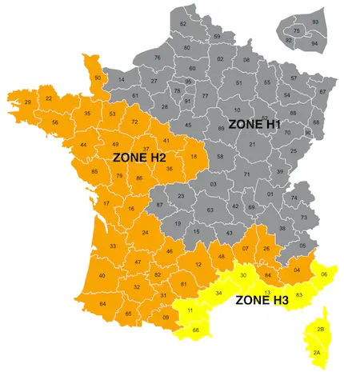
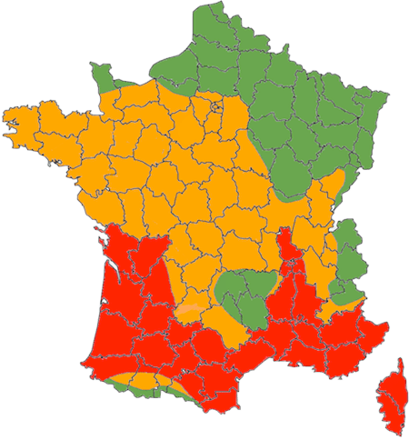

## Quels sont les différents types de pompes à chaleur ?

Les pompes à chaleur (PAC) se déclinent en plusieurs types, chacun ayant ses propres caractéristiques et avantages. Comprendre ces différences est essentiel pour choisir le système le plus adapté à votre logement et à votre région.

### Qu'est-ce qu'une pompe à chaleur air-air ?

La pompe à chaleur air/air, également connue sous le nom de climatisation réversible, est un système qui puise les calories présentes dans l'air extérieur pour les restituer à l'intérieur de votre logement. Ce type de PAC est particulièrement apprécié dans les régions chaudes, où il peut également servir de climatiseur en été. Cependant, il est important de noter que son efficacité peut diminuer par temps très froid, ce qui peut nécessiter un chauffage d'appoint dans les régions les plus froides. À noter également quelle ne permet pas de produire d'eau chaude sanitaire, et ne nécessite donc pas de chauffage centrale. Elles sont donc un mode de chauffage à part entière.

### Qu'est-ce qu'une pompe à chaleur air-eau ?

La pompe à chaleur air/eau fonctionne sur un principe similaire à la PAC air/air, mais elle utilise les calories de l'air extérieur pour chauffer de l'eau, qui est ensuite distribuée dans le système de chauffage central de votre logement. Ce type de PAC est particulièrement adapté aux maisons équipées de radiateurs ou de planchers chauffants. Les modèles les plus récents sont capables de fonctionner efficacement même par des températures extérieures très basses, ce qui les rend adaptés à une grande variété de climats. Ce sont aujourd'hui les pompes chaleur les plus courantes.

### Qu'est-ce qu'une pompe à chaleur géothermique ?

La pompe à chaleur géothermique puise les calories présentes dans le sol pour chauffer votre logement. Ce type de PAC est particulièrement efficace et stable, car la température du sol reste relativement constante tout au long de l'année. Cependant, son installation est plus complexe et coûteuse, car elle nécessite des travaux de forage ou de terrassement pour installer les capteurs souterrains. Malgré ces contraintes, la pompe à chaleur géothermique offre une excellente performance énergétique et est adaptée à toutes les régions, y compris les plus froides.

### Qu'est-ce qu'une pompe à chaleur hydrothermique ?

La pompe à chaleur hydrothermique utilise les calories présentes dans les nappes phréatiques pour chauffer votre logement. Ce type de PAC est particulièrement efficace, car la température de l'eau souterraine est relativement stable tout au long de l'année. Cependant, son installation est soumise à des contraintes géologiques et réglementaires, car elle nécessite un accès à une nappe phréatique. Malgré ces contraintes, la pompe à chaleur hydrothermique offre une excellente performance énergétique et est adaptée à une grande variété de climats.

## Comment les pompes à chaleur fonctionnent-elles selon les régions ?

La France est divisée en plusieurs zones climatiques, chacune ayant ses propres caractéristiques en termes de température et d'humidité. Ces différences climatiques ont un impact significatif sur l'efficacité des pompes à chaleur. Comprendre ces variations est important pour choisir le système de chauffage le plus adapté à votre région.

### Quelles sont les zones climatiques en France (H1, H2, H3) ?

La France est divisée en trois grandes zones climatiques : H1, H2 et H3. La zone H1 regroupe les départements où les températures hivernales sont les plus froides, principalement situés dans l'Est et le Nord de la France. La zone H2 comprend les départements où les hivers sont plus tempérés, principalement situés dans l'Ouest de la France. Enfin, la zone H3 correspond aux territoires du pourtour méditerranéen, où les hivers sont doux et les étés chauds.

<figure>
  
  <figcaption>Zones climatiques en France</figcaption>
</figure>

### Quelles sont les performances des PAC dans les différentes zones ?

Les performances des pompes à chaleur varient considérablement en fonction de la zone climatique. Dans les régions froides (zone H1), les pompes à chaleur air/air voit leur efficacité diminuer par temps très froid, nécessitant parfois un chauffage d'appoint. Les pompes à chaleur air-eau fonctionne bien dans ces régions à condition d'avoir un logement bien isolé ou d'installer une pompe à chaleur haute température ([pour en savoir plus sur comment fonctionne les pompes à chaleur air-eau par temps très froid rendez-vous sur notre article qui présente le sujet](/post/fonctionnement-des-pompes-a-chaleur-aerothermiques-en-periode-de-grand-froid)) Une autre solution sont [les pompes à chaleur hybride (en savoir plus sur le sujet avec notre article)](/post/tout-savoir-sur-les-pompes-a-chaleur-hybrides-fonctionnement-avantages-et-installation) ou la possibilité d'installer un chauffage d'appoint type poêle à bois. En revanche, les pompes à chaleur géothermiques et hydrothermiques, qui puisent les calories dans le sol ou les nappes phréatiques, sont moins affectées par les variations de température et offrent une performance très stable ce qui en font une solution de choix dans ces régions à condition d'être en capacité d'installer ce type de pompe ([voir les contraintes](/post/pompe-a-chaleur-geothermique-tout-ce-que-vous-devez-savoir)).

Dans les régions tempérées (zone H2), les pompes à chaleur air/air et air/eau fonctionnent généralement de manière optimale, offrant un bon équilibre entre performance et coût. Enfin, dans les régions méditerranéennes (zone H3), les pompes à chaleur air/air sont particulièrement adaptées, car elles peuvent également servir de climatiseurs en été. Au même titre

## Les pompes à chaleur sont-elles efficaces en période de grand froid ?

L'efficacité des pompes à chaleur en période de grand froid est une question cruciale pour de nombreux propriétaires, surtout ceux vivant dans des régions où les températures peuvent chuter de manière importante au cours de l'année (en dessous de -5°C plusieurs dizaines d'heures par an. Comprendre comment ces systèmes fonctionnent par temps froid peut vous aider à faire un choix éclairé.

### Quelle est la plage de fonctionnement des PAC ?

Les pompes à chaleur modernes sont conçues pour fonctionner efficacement dans une large plage de températures. Les modèles les plus récents peuvent continuer à produire du chauffage même lorsque les températures extérieures descendent jusqu'à -20°C. Cependant, il est important de noter que l'efficacité des PAC diminue à mesure que les températures chutent. Par exemple, une pompe à chaleur air/eau standard voit son efficacité diminuer en dessous de -5°C, nécessitant parfois un chauffage d'appoint pour maintenir une température confortable à l'intérieur au risque de surconsommer.

### Quelles sont les performances par grand froid ?

Les performances des pompes à chaleur par grand froid dépendent largement du type de système installé. Les pompes à chaleur géothermiques et hydrothermiques, qui puisent les calories dans le sol ou les nappes phréatiques, sont moins affectées par les variations de température et offrent une performance plus stable même par temps très froid. En revanche, les pompes à chaleur air/air et air/eau, qui puisent les calories dans l'air extérieur, peuvent voir leur efficacité diminuer par temps très froid. Aujourd'hui les pompes à chaleur air- eau basse température sont fabriquées pour être efficace jusqu'a -5°C -10°C minimum, si dans votre région (H1 surtout) la température descend plusieurs jours par an, il est nécessaire de passer à une [pompe à chaleur haute température](/post/pompe-a-chaleur-haute-temperature-avantages-inconvenients-et-applications). Les pompes à chaleur air-air ne seront plus du toute efficace en dessous de -5°C et consommeront beaucoup d'énergie.

### Faut-il un chauffage d’appoint ?

Il est également important de noter que les pompes à chaleur hybrides, qui combinent une pompe à chaleur avec un système de chauffage d'appoint (comme une chaudière à gaz ou à fioul), peuvent offrir une solution efficace pour les régions où les températures peuvent chuter de manière significative. Ces systèmes peuvent basculer automatiquement vers le chauffage d'appoint lorsque les températures extérieures deviennent trop basses, assurant ainsi un confort thermique optimal.

La nécessité d'un chauffage d'appoint dépend largement du type de pompe à chaleur installé et des conditions climatiques de votre région. Dans les régions où les températures peuvent chuter de manière significative, un chauffage d'appoint peut être nécessaire pour maintenir une température confortable à l'intérieur. Cependant, dans les régions où les hivers sont plus tempérés, une pompe à chaleur seule peut suffire à répondre à vos besoins en chauffage.

Elles sont une solution efficace pour les régions où les températures peuvent chuter de manière significative. Ces systèmes peuvent basculer automatiquement vers le chauffage d'appoint lorsque les températures extérieures deviennent trop basses, assurant ainsi un confort thermique optimal.

## Quelles sont les conditions requises pour l'installation d'une PAC ?

L'installation d'une pompe à chaleur (PAC) est une décision importante qui peut considérablement améliorer l'efficacité énergétique de votre logement. Cependant, pour tirer pleinement parti de ce système de chauffage, certaines conditions doivent être remplies. Examinons les principales exigences pour une installation réussie.

### Pourquoi avoir une maison bien isolée est-il important ?

Une isolation adéquate de votre maison est important pour maximiser l'efficacité de votre pompe à chaleur. Une maison bien isolée réduit les déperditions de chaleur, permettant à la PAC de fonctionner de manière optimale avec moins d'effort. Cela se traduit par une consommation d'énergie réduite et des factures de chauffage plus basses.

Avant d'installer une pompe à chaleur, il est recommandé de réaliser un audit énergétique pour identifier les zones de votre maison qui nécessitent une meilleure isolation. Cela peut inclure l'isolation des combles, des murs, des fenêtres et des portes. Une isolation efficace permet non seulement d'améliorer le confort thermique de votre logement, mais aussi de prolonger la durée de vie de votre pompe à chaleur en réduisant sa charge de travail.

### Pourquoi posséder un système de chauffage central est-il nécessaire ?

La plupart des pompes à chaleur, en dehors des modèles air-air nécessitent un système de chauffage central pour distribuer la chaleur dans toute la maison. Cela peut inclure des radiateurs, des planchers chauffants ou des ventilo-convecteurs. Si votre maison n'est pas déjà équipée d'un tel système, son installation peut représenter un coût supplémentaire.

Dans le cas d'une rénovation, il peut être nécessaire de prévoir des travaux pour installer un réseau de distribution de chaleur. Cela peut inclure la pose de tuyaux, l'installation de radiateurs ou de planchers chauffants, et la mise en place d'un système de régulation thermique. Ces travaux peuvent être coûteux, mais ils sont essentiels pour garantir le bon fonctionnement de votre pompe à chaleur.

### Comment réaliser un bilan thermique et calculer la puissance ?

Avant d'installer une pompe à chaleur, il est indispensable de réaliser un bilan thermique de votre logement. Ce bilan permet de déterminer la puissance nécessaire pour chauffer votre maison de manière efficace. Un professionnel qualifié peut effectuer cette évaluation en tenant compte de plusieurs facteurs, tels que la superficie de votre logement, le niveau d'isolation, le nombre d'occupants et les conditions climatiques de votre région.

Le calcul de la puissance nécessaire pour votre pompe à chaleur est basé sur le volume de votre logement, l'écart de température entre l'intérieur et l'extérieur, et le coefficient de déperdition d'énergie. Une fois ces données recueillies, le professionnel peut vous recommander un modèle de pompe à chaleur adapté à vos besoins spécifiques.

En résumé, l'installation d'une pompe à chaleur nécessite une maison bien isolée, un système de chauffage central et un bilan thermique précis. En respectant ces conditions, vous pouvez maximiser l'efficacité de votre système de chauffage et réaliser des économies d'énergie significatives. Dans la section suivante, nous explorerons comment choisir la bonne pompe à chaleur pour votre logement.

### Quel est la pompe à chaleur adaptée à votre département?

Choisir la bonne pompe à chaleur (PAC) pour votre logement est une décision importante qui aura un impact sur votre confort et vos factures d'énergie. Plusieurs critères doivent être pris en compte pour faire le meilleur choix.

### Les critères de choix

Plusieurs critères entrent en jeu lors du choix d'une pompe à chaleur. Tout d'abord, il est essentiel de considérer le type de PAC qui convient le mieux à votre logement et à votre région. Les pompes à chaleur air/air sont idéales pour les régions chaudes, tandis que les modèles géothermiques ou hydrothermiques sont plus adaptés aux régions très froides mais ont des contraintes d'installation importantes. Enfin les modèles air-eau sont adaptés à tous les departements.

Ensuite, la puissance de la pompe à chaleur est un facteur crucial. Une PAC sous-dimensionnée ne pourra pas chauffer votre logement de manière efficace, tandis qu'une PAC surdimensionnée entraînera une consommation d'énergie excessive. Un professionnel qualifié sera vous aider à déterminer la puissance appropriée en fonction de la superficie de votre logement, de son niveau d'isolation et des conditions climatiques de votre région.

Enfin, il est important de considérer le coût d'installation et de fonctionnement de la pompe à chaleur. Les modèles géothermiques et hydrothermiques ont des coûts d'installation plus élevés en raison des travaux de forage ou de terrassement nécessaires, mais ils offrent une meilleure efficacité énergétique à long terme. Les pompes à chaleur air/air et air/eau sont généralement moins coûteuses à installer, mais leur efficacité peut varier en fonction des conditions climatiques.

### Les conseils pour le choix d'une PAC adaptée ?

Pour choisir une pompe à chaleur adaptée à vos besoins, il est recommandé de suivre quelques conseils pratiques. Tout d'abord, faites réaliser un bilan thermique de votre logement par un professionnel qualifié. Ce bilan vous permettra de déterminer la puissance nécessaire pour chauffer votre maison de manière efficace. [Pour en savoir plus sur le dimensionnement d'une pompe à chaleur vous pouvez consulter notre article sur le sujet.](/post/comment-bien-dimensionner-sa-climatisation-pompe-a-chaleur-air-air-pour-un-confort-thermique-optimal)

Ensuite, prenez le temps de comparer les différents modèles de pompes à chaleur disponibles sur le marché. Consultez les avis des utilisateurs et les tests indépendants pour vous faire une idée de la performance et de la fiabilité de chaque modèle. N'hésitez pas à demander des devis à plusieurs installateurs pour comparer les prix et les services proposés.

Enfin, tenez compte du nombre d'occupants de votre logement. Plus il y a d'occupants, plus les besoins en chaleur sont réguliers. Une pompe à chaleur plus puissante peut être nécessaire pour répondre à ces besoins. Un professionnel qualifié peut vous aider à déterminer la puissance appropriée en fonction de vos besoins spécifiques.

## Est-ce que mon département est adapté à une pompe à chaleur ?

Choisir une pompe à chaleur (PAC) adaptée à votre département est important pour garantir une efficacité énergétique optimale et un confort thermique toute l'année. La France est divisée en trois zones climatiques principales, chacune ayant ses propres caractéristiques et exigences en matière de chauffage. Examinons comment déterminer si votre département est adapté à une pompe à chaleur.

<figure>
  
  <figcaption>Carte des territoires où une pompe à chaleur air-eau est une solution intéressante</figcaption>
</figure>

**Région optimale** : Surement la meilleure solution avec un besoin de chauffage relativement important et des hivers tempérés. Rentabilité maximale.

**Région intéressante** : Elle sera très performante dans ces régions cependant elle est limitée sur l'aspect climatisation (réservée au plancher chauffant) ce qui peut-être une contrainte dans ces régions aux étés de plus en plus chauds. [La PAC air-air peut avoir plus de sens](/post/pompe-a-chaleur-air-air-vs-air-eau-guide-complet-pour-faire-le-bon-choix).

**Région à étudier** : Très intéressant économiquement et écologiquement car besoin de chauffage important mais uniquement si le bien est bien isolé. Sinon les solutions biomasses ou gaz reste pour le moment plus intéressante.

## Conclusion

Les pompes à chaleur (PAC) offrent une solution de chauffage efficace et durable pour les logements en France. Leur performance varie selon les conditions climatiques et géographiques, rendant crucial le choix d'un système adapté à votre région. En comprenant les différents types de PAC, leur adaptation aux zones climatiques, et les conditions requises pour leur installation, vous pouvez optimiser l'efficacité énergétique de votre logement.

Les pompes à chaleur air/air sont idéales pour les régions chaudes, tandis que les modèles géothermiques ou hydrothermiques sont plus adaptés aux régions froides. Les pompes à chaleur air-eau offrent un bon équilibre entre performance et coût, et sont adaptées à une grande variété de climats.

L'installation d'une pompe à chaleur nécessite une maison bien isolée, un système de chauffage central, un bilan thermique précis et un dimensionnement adapté à votre région. En respectant ces conditions, vous pouvez maximiser l'efficacité de votre système de chauffage et réaliser des économies d'énergie importante.

Il est également intéressant de consulter les différentes aides financières disponibles pour réduire le coût d'installation des pompes à chaleur, les rendant plus accessibles aux ménages. Consultez un professionnel qualifié pour des conseils personnalisés et maximisez les aides financières disponibles.
