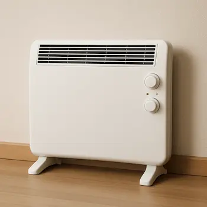
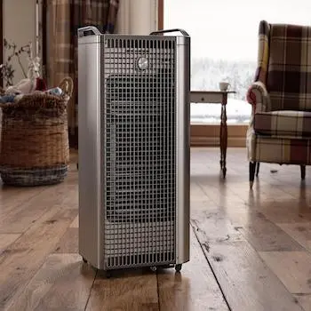
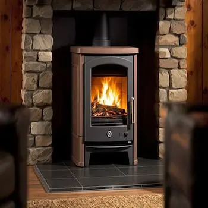
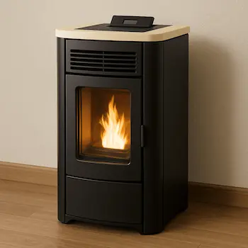

### Radiateurs électriques : avantages et inconvénients

Les radiateurs électriques sont une solution courante pour le chauffage d'appoint, appréciés pour leur simplicité d'installation, leur facilité d'utilisation et leur coût faibles. Ils offrent une chaleur rapide et sont disponibles dans une large gamme de modèles, allant des radiateurs à bain d'huile aux radiateurs soufflants.

**Avantages :**

- **Facilité d'installation et d'utilisation** : Les radiateurs électriques peuvent être installés rapidement et facilement, sans nécessiter de travaux complexes. Il suffit de les brancher sur une prise électrique pour qu'ils fonctionnent.
- **Chaleur rapide** : Ils fournissent une chaleur presque instantanée, ce qui est idéal pour chauffer rapidement une pièce.
- **Large gamme de modèles** : Il existe une grande variété de radiateurs électriques, adaptés à différents besoins et budgets.
- **Budget d'achat :** on trouve des modèles à tous les prix comptez une quelques centaines d'euros par unité pour des produits de qualités.

**Inconvénients :**

- **Coût énergétique élevé** : Les radiateurs électriques consomment beaucoup d'électricité, ce qui peut entraîner des factures d'énergie élevées.
- **Sécheresse de l'air** : Ils peuvent assécher l'air, ce qui peut causer des irritations des voies respiratoires et de la peau.
- **Risque de surchauffe** : Certains modèles peuvent surchauffer, ce qui peut poser des risques de sécurité.

<figure>
  
  <figcaption>Exemple de radiateur électrique</figcaption>
</figure>

### Chauffages à gaz : avantages et inconvénients

Les chauffages à gaz sont une autre option populaire pour le chauffage d'appoint. Ils offrent une chaleur rapide et efficace, et sont souvent moins coûteux à l'utilisation que les radiateurs électriques.

**Avantages :**

- **Chaleur rapide et efficace** : Les chauffages à gaz fournissent une chaleur presque instantanée, ce qui est idéal pour chauffer rapidement une pièce.
- **Coût énergétique inférieur** : Le gaz est généralement moins cher que l'électricité, ce qui peut entraîner des économies sur les factures d'énergie.
- **Large gamme de modèles** : Il existe une grande variété de chauffages à gaz, adaptés à différents besoins et budgets.

**Inconvénients :**

- **Nécessité d'une ventilation adéquate** : Les chauffages à gaz nécessitent une bonne ventilation pour éviter l'accumulation de monoxyde de carbone, un gaz dangereux.
- **Risque d'émission de monoxyde de carbone** : En cas de mauvaise ventilation, les chauffages à gaz peuvent émettre du monoxyde de carbone, ce qui peut être mortel.
- **Coût initial élevé** : Les chauffages à gaz peuvent être plus chers à l'achat et à l'installation que les radiateurs électriques.

<figure>
  
  <figcaption>Exemple de chauffage d&#x27;appoint au gaz</figcaption>
</figure>

### Poêles à bois : avantages et inconvénients

Les poêles à bois sont une solution de chauffage d'appoint de plus en plus populaire, grâce à leur efficacité et leur faible coût énergétique. Ils offrent une chaleur agréable et conviviale, et sont souvent appréciés pour leur esthétique et leur design.

**Avantages :**

- **Coût énergétique faible** : Le bois est généralement moins cher que l'électricité ou le gaz, ce qui peut entraîner des économies sur les factures d'énergie.
- **Chaleur agréable et conviviale** : Les poêles à bois fournissent une chaleur douce et homogène, créant une ambiance chaleureuse et conviviale.
- **Esthétique et design** : Les poêles à bois sont disponibles dans une large gamme de styles et de designs, ce qui permet de les intégrer harmonieusement dans la décoration de la maison.

**Inconvénients :**

- **Nécessité d'un conduit de fumée** : Les poêles à bois nécessitent un conduit de fumée pour évacuer les gaz de combustion, ce qui peut compliquer l'installation.
- **Entretien régulier nécessaire** : Les poêles à bois nécessitent un entretien régulier, notamment le nettoyage des cendres et le ramonage du conduit de fumée.
- **Pollution aux particules fines** : Les poêles à bois émettent des particules fines lors de la combustion du bois, ont des effets néfastes sur la santé et l'environnement notamment en aggravant les problèmes respiratoires. Il est donc important de choisir un poêle à bois performant et de l'utiliser correctement pour minimiser les émissions de particules fines.

<figure>
  
  <figcaption>Exemple d&#x27;un poêle à bois</figcaption>
</figure>

### Poêles à granulés : avantages, inconvénients et pollution aux particules fines

Les poêles à granulés sont une alternative aux poêles à bois, offrant une efficacité énergétique similaire avec une pollution aux particules fines réduite.

**Avantages :**

- **Coût énergétique faible** : Les granulés de bois sont généralement moins chers que l'électricité ou le gaz, ce qui peut entraîner des économies sur les factures d'énergie.
- **Chaleur agréable et conviviale** : Les poêles à granulés fournissent une chaleur douce et homogène, créant une ambiance chaleureuse et conviviale.
- **Pollution aux particules fines réduite** : Les poêles à granulés émettent moins de particules fines que les poêles à bois, grâce à une combustion plus complète et contrôlée.

**Inconvénients :**

- **Coût initial élevé** : Les poêles à granulés peuvent être plus chers à l'achat et à l'installation que les poêles à bois.
- **Nécessité d'un conduit de fumée** : Les poêles à granulés nécessitent un conduit de fumée pour évacuer les gaz de combustion, ce qui peut compliquer l'installation.
- **Entretien régulier nécessaire** : Les poêles à granulés nécessitent un entretien régulier, notamment le nettoyage des cendres et le ramonage du conduit de fumée.

<figure>
  
  <figcaption>Exemple d&#x27;un poêle à granulés</figcaption>
</figure>

D'autres types de chauffages d'appoint existent, tels que les poêles à pétrole et les cheminées à l'éthanol. Cependant, ces solutions sont de moins en moins pertinentes en raison de leur faible efficacité énergétique, de leur coût élevé et de leur impact environnemental négatif. Les poêles à pétrole, par exemple, sont connus pour leur pollution élevée et leur coût énergétique prohibitif, tandis que les cheminées à l'éthanol sont souvent utilisées à des fins purement décoratives en raison de leur faible capacité de chauffage et de leur coût énergétique élevé.

## Pourquoi choisir un poêle à bois ou à granulés comme chauffage d'appoint ?

Les poêles à bois et à granulés sont de plus en plus populaires comme solutions de chauffage d'appoint, et ce pour plusieurs raisons. Ils offrent des avantages économiques, écologiques et pratiques qui les rendent particulièrement attractifs.

### Avantages économiques et écologiques

**Coût énergétique faible :**Les poêles à bois et à granulés utilisent des combustibles relativement peu coûteux. Le bois et les granulés de bois sont généralement moins chers que l'électricité ou le gaz, ce qui peut entraîner des économies significatives sur les factures d'énergie. De plus, ces combustibles sont souvent disponibles localement, ce qui réduit les coûts de transport et soutient l'économie locale.

**Écologie :**Le bois est une ressource renouvelable, ce qui en fait une option plus écologique que les combustibles fossiles. Les poêles à granulés, en particulier, sont conçus pour une combustion plus complète et contrôlée, ce qui réduit les émissions de particules fines et d'autres polluants. Cela en fait une option plus respectueuse de l'environnement par rapport aux chauffages à gaz ou à pétrole.

### Confort thermique et convivialité

**Chaleur agréable et conviviale :**Les poêles à bois et à granulés fournissent une chaleur douce et homogène, créant une ambiance chaleureuse et conviviale dans la maison. La chaleur rayonnante des poêles à bois et à granulés est particulièrement appréciée pour son confort et son effet apaisant.

**Esthétique et design :**Les poêles à bois et à granulés sont disponibles dans une large gamme de styles et de designs, ce qui permet de les intégrer harmonieusement dans la décoration de la maison. Ils peuvent devenir un élément central de la pièce, ajoutant une touche de charme et de convivialité.

### Comparaison avec d'autres types de chauffages d'appoint

**Radiateurs électriques :**Bien que les radiateurs électriques soient faciles à installer et à utiliser, ils consomment beaucoup d'électricité, ce qui peut entraîner des factures d'énergie élevées. De plus, ils peuvent assécher l'air, ce qui peut causer des irritations des voies respiratoires et de la peau.

**Chauffages à gaz :**Les chauffages à gaz offrent une chaleur rapide et efficace, mais ils nécessitent une bonne ventilation pour éviter l'accumulation de monoxyde de carbone, un gaz dangereux. De plus, ils peuvent être plus chers à l'achat et à l'installation que les radiateurs électriques.

**Poêles à pétrole et cheminées à l'éthanol :**Ces options sont de moins en moins pertinentes en raison de leur faible efficacité énergétique, de leur coût élevé et de leur impact environnemental négatif. Les poêles à pétrole sont connus pour leur pollution élevée et leur coût énergétique prohibitif, tandis que les cheminées à l'éthanol sont souvent utilisées à des fins purement décoratives en raison de leur faible capacité de chauffage et de leur coût énergétique élevé.

En conclusion, les poêles à bois et à granulés se distinguent comme des solutions de chauffage d'appoint particulièrement avantageuses. Ils offrent des avantages économiques, écologiques et pratiques qui les rendent attractifs pour de nombreux foyers. Leur capacité à fournir une chaleur agréable et conviviale, combinée à leur esthétique et leur design, en fait des options de choix pour ceux qui cherchent à optimiser leur chauffage.

## Quels sont les avantages du couplage PAC et poêle à bois ou à granulés ?

Le couplage d'une pompe à chaleur (PAC) avec un poêle à bois ou à granulés offre de nombreux avantages, tant sur le plan économique qu'écologique et en termes de confort thermique. Voici les principaux bénéfices de cette combinaison.

### Réduction des coûts énergétiques

**Économies sur les factures d'énergie :** L'un des principaux avantages du couplage d'une PAC avec un poêle à bois ou à granulés est la réduction des coûts énergétiques. Les PAC sont connues pour leur efficacité énergétique, car elles utilisent l'énergie renouvelable de l'air, de l'eau ou du sol pour chauffer la maison. En utilisant une PAC comme système de chauffage principal, vous pouvez réduire considérablement votre consommation d'énergie. Les poêles à bois ou à granulés, quant à eux, utilisent des combustibles relativement peu coûteux, ce qui permet de réaliser des économies supplémentaires sur les factures d'énergie.

**Optimisation de l'utilisation des systèmes :** En utilisant la PAC comme système de chauffage principal et le poêle à bois ou à granulés comme chauffage d'appoint, vous pouvez optimiser l'utilisation de chaque système. Par exemple, la PAC peut être utilisée pour chauffer la maison pendant les périodes de température modérée, tandis que le poêle à bois ou à granulés peut être utilisé lors des périodes de grand froid. Cela permet de réduire la consommation d'énergie et de réaliser des économies sur les factures.

### Amélioration du confort thermique

**Chaleur homogène et confortable :** Les PAC offrent une chaleur constante et homogène, ce qui est idéal pour maintenir une température confortable dans toute la maison. Les poêles à bois ou à granulés, quant à eux, fournissent une chaleur douce et conviviale, créant une ambiance chaleureuse et agréable. En combinant les deux systèmes, vous pouvez profiter d'une chaleur homogène et confortable dans toute la maison, tout en bénéficiant de l'ambiance chaleureuse et conviviale des poêles à bois ou à granulés.

**Adaptabilité aux conditions météorologiques :** Les PAC sont efficaces pour chauffer la maison pendant les périodes de température modérée, mais leur efficacité peut diminuer par temps très froid en dessous de 5°C ([voir notre article sur le sujet](/post/quelles-sont-les-regions-adaptees-aux-pompes-a-chaleur)). En utilisant un poêle à bois ou à granulés comme chauffage d'appoint, vous pouvez adapter votre système de chauffage aux conditions météorologiques. Par exemple, vous pouvez utiliser la PAC pour chauffer la maison pendant les périodes de température modérée et le poêle à bois ou à granulés lors des périodes de grand froid, ce qui permet de maintenir une température confortable dans toute la maison.

### Réduction de l'empreinte carbone

**Utilisation de sources d'énergie renouvelable :** Les PAC utilisent l'énergie renouvelable de l'air, de l'eau ou du sol pour chauffer la maison, ce qui en fait une option de chauffage écologique. Les poêles à bois ou à granulés, quant à eux, utilisent des combustibles renouvelables, ce qui permet de réduire l'empreinte carbone de votre système de chauffage. En combinant les deux systèmes, vous pouvez réduire considérablement votre empreinte carbone et contribuer à la protection de l'environnement.

**Réduction des émissions de CO2 :** Les PAC et les poêles à bois ou à granulés émettent moins de CO2 que les systèmes de chauffage traditionnels, ce qui permet de réduire les émissions de gaz à effet de serre. En utilisant une PAC comme système de chauffage principal et un poêle à bois ou à granulés comme chauffage d'appoint, vous pouvez réduire considérablement vos émissions de CO2 et contribuer à la lutte contre le changement climatique.

## Comment coupler une pompe à chaleur avec un poêle à bois ou à granulés ?

Coupler une pompe à chaleur (PAC) avec un poêle à bois ou à granulés peut offrir une solution de chauffage optimale, combinant les avantages des deux systèmes. Voici les étapes à suivre pour une installation réussie, ainsi que des exemples de configurations possibles.

### Étapes à suivre pour une installation réussie

- **Évaluation des besoins en chauffage :**
  - **Analyse des besoins énergétiques** : Évaluez les besoins en chauffage de votre maison en fonction de sa taille, de son isolation et de son emplacement géographique. Cela vous aidera à déterminer la puissance nécessaire pour la PAC et le poêle à bois ou à granulés. [Pour en savoir plus sur le dimensionnement suivez notre guide.](/post/comment-bien-dimensionner-sa-climatisation-pompe-a-chaleur-air-air-pour-un-confort-thermique-optimal)

- **Consultation d'un professionnel** : Faites appel à un professionnel pour une évaluation précise de vos besoins et pour obtenir des conseils sur les systèmes les plus adaptés à votre situation.
- **Choix du système de pompe à chaleur :**
  - **PAC air-air** : Idéale pour les maisons bien isolées, elle offre une solution de chauffage et de climatisation. Elle est généralement plus facile à installer et moins coûteuse que les autres types de PAC.
  - **PAC air-eau** : Plus adaptée pour les maisons avec un système de chauffage central existant, elle permet également de chauffer l'eau sanitaire. Elle est plus complexe à installer et plus coûteuse, mais offre une efficacité énergétique supérieure.
- **Choix du poêle à bois ou à granulés :**
  - **Poêle à bois** : Choisissez un poêle à bois performant et adapté à la taille de votre maison. Assurez-vous qu'il est conforme aux normes de sécurité et d'émission de particules fines.
  - **Poêle à granulés** : Optez pour un poêle à granulés avec une bonne efficacité énergétique et une faible émission de particules fines. Assurez-vous qu'il est compatible avec votre système de chauffage existant.
- **Installation des systèmes :**
  - **Installation de la PAC** : Faites appel à un professionnel pour installer la PAC. Assurez-vous que l'unité extérieure est placée dans un endroit bien ventilé et que l'unité intérieure est correctement connectée au système de chauffage. Pour en savoir plus sur [comment installer convenablement votre PAC suivez notre guide.](/post/ou-installer-sa-pompe-a-chaleur-pour-une-configuration-optimale-le-guide)
  - **Installation du poêle à bois ou à granulés** : Faites appel à un professionnel pour installer le poêle. Assurez-vous que le conduit de fumée est correctement installé et que le poêle est conforme aux normes de sécurité.

#### Exemples de configurations possibles

1. **PAC air-air avec poêle à bois :**
  - **Configuration** : La PAC air-air est utilisée comme système de chauffage principal, tandis que le poêle à bois est utilisé comme chauffage d'appoint lors des périodes de grand froid.
  - **Avantages** : Cette configuration offre une solution de chauffage et de climatisation efficace, avec un chauffage d'appoint convivial et économique.
2. **PAC air-eau avec poêle à granulés :**
  - **Configuration** : La PAC air-eau est utilisée comme système de chauffage principal, tandis que le poêle à granulés est utilisé comme chauffage d'appoint lors des périodes de grand froid.
  - **Avantages** : Cette configuration offre une solution de chauffage efficace et écologique, avec un chauffage d'appoint performant et peu polluant.

### Conclusion

Le couplage d'une pompe à chaleur (PAC) avec un poêle à bois ou à granulés offre une solution de chauffage optimale, combinant efficacité énergétique, confort thermique et respect de l'environnement. Surtout pour les régions les plus froides ([voir notre article sur le sujet](/post/quelles-sont-les-regions-adaptees-aux-pompes-a-chaleur)). Pour les autres territoires, la pompe à chaleur à elle seule sera largement suffisante et le poêle ne servira alors qu'à procurer le réconfort du feu de bois pour les journées les plus froides. Mais il n'aura aucun intérêt économique particulier.

**Avantages clés :**

- **Économies d'énergie** : Réduction des coûts grâce à l'efficacité de la PAC et au faible coût des combustibles des poêles.
- **Confort thermique** : Chaleur constante de la PAC et ambiance conviviale des poêles.
- **Écologie** : Utilisation de sources d'énergie renouvelable, réduisant l'empreinte carbone.

Adoptez cette solution pour un chauffage performant, économique et écologique, adapté à vos besoins et aux conditions météorologiques. Consultez un professionnel pour des conseils personnalisés.
